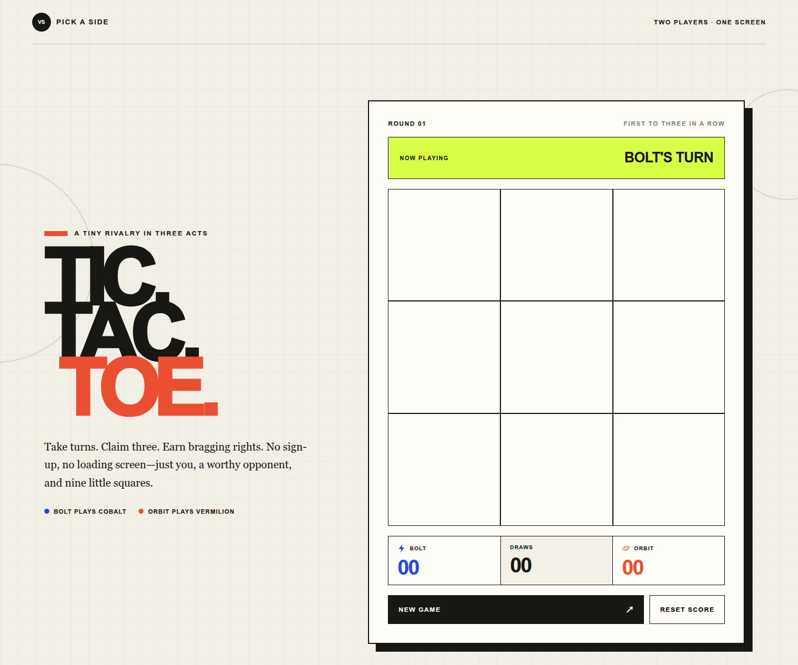

# Pick a Side — Tic-Tac-Toe

A responsive two-player Tic-Tac-Toe game built for the SUpost React + Next.js hiring test.



## Features

- Alternating two-player turns with realistic sword and shield marks on a 3×3 board
- Win and draw detection with winning-cell highlights
- A New Game control that resets the board
- Session scoreboard for Sword, Shield, and draws
- Responsive layout, keyboard-friendly controls, and live status announcements
- Small celebratory animation after a win

## Run locally

```bash
npm install
npm run dev
```

Open [http://localhost:3000](http://localhost:3000).

## Quality checks

```bash
npm run lint
npm test
npm run build
```

## Deploy to Vercel

Import this public repository into Vercel, or deploy with the CLI:

```bash
npx vercel --prod
```

Submit the public production URL (normally `https://your-project-name.vercel.app`), not a protected preview deployment.
